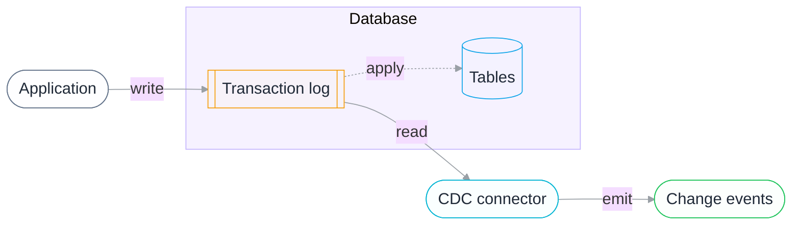
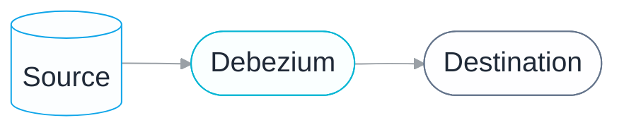
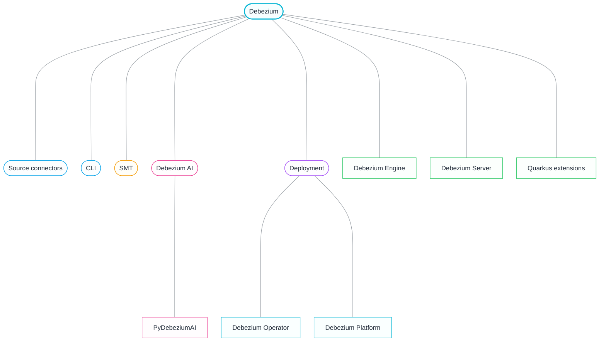
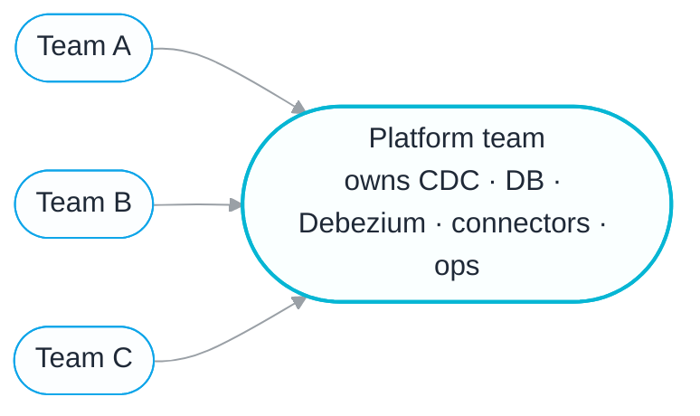
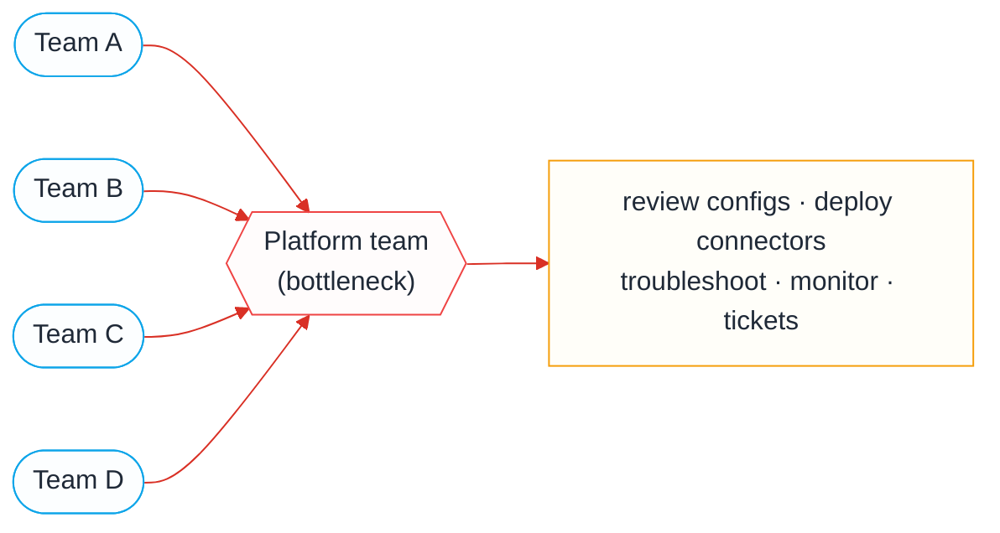
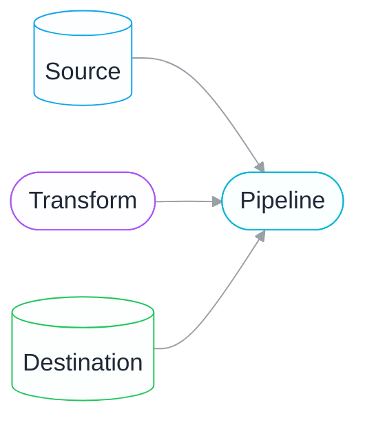
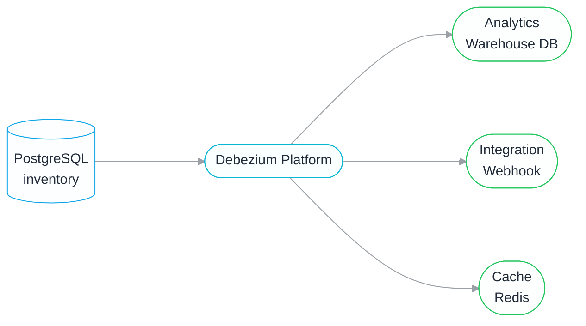

# Beyond the First Pipeline
## Scaling Data Pipelines Across Teams

Vincenzo Santonastaso

---
layout: center
---

# About me

  

    
Vincenzo Santonastaso

    
Senior Software Engineer @ IBM Java Runtimes & Integrations

    
Core maintainer of Debezium

    
Open source contributor

  

  

The content of this presentation reflects my own opinions and does not represent the views of IBM.

---

# Agenda

  
Foundations

  
The scaling problem

  
Debezium Platform

  
Demo

  
Takeaways

---

# Let's start from the foundations

  

  Data pipelines
  Change Data Capture
  Debezium

---

# Data pipeline

**Ingest raw data from one or more sources, transform it, and load it where it's needed.**

```mermaid
%%{init: {'theme':'base','themeVariables':{'fontFamily':'Inter, Helvetica, Arial','fontSize':'18px','lineColor':'#94a3b8'},'flowchart':{'curve':'basis','padding':16},'themeCSS':'@keyframes dbzflow { to { stroke-dashoffset: -7; } } .edgePaths path, .flowchart-link { stroke-dasharray: 1.5 5.5 !important; stroke-linecap: round; stroke-width: 1.5px !important; animation: dbzflow 0.6s linear infinite; } .node.src, .node.db, .node.team, .node.user { --s: #0ea5e9; } .node.t { --s: #a855f7; } .node.dst, .node.ev, .node.run { --s: #22c55e; } .node.app, .node.sink, .node.free, .node.ops { --s: #64748b; } .node.log, .node.need, .node.work, .node.obs { --s: #f59e0b; } .node.dbz, .node.plt, .node.pipe { --s: #06b6d4; } .node.bottle { --s: #ef4444; } .node rect { rx: 10px; ry: 10px; } .node :is(rect,path,polygon,circle,ellipse):not(.label *) { filter: drop-shadow(0 0 2.5px var(--s, #06b6d4)); } .node .label, .node .label * { filter: none !important; text-shadow: none !important; } .nodeLabel, .nodeLabel p { font-weight: 400 !important; text-shadow: none !important; color: #1f2937 !important; } .edgeLabel, .edgeLabel p, .edgeLabel span { background-color: #fafafa !important; color: #475569 !important; }'}}%%
flowchart LR
  SRC[(Ingestion<br/>)]:::src --> T([Processing<br/>]):::t --> DST[(Storage<br/>)]:::dst
  classDef src fill:#e0f2fe1a,stroke:#0ea5e9,stroke-width:1px,color:#1f2937;
  classDef t fill:#f3e8ff1a,stroke:#a855f7,stroke-width:1px,color:#1f2937;
  classDef dst fill:#dcfce71a,stroke:#22c55e,stroke-width:1px,color:#1f2937;
```

### Three stages
- **Ingestion**: pull from DBs, APIs, SaaS, IoT, files
- **Processing**: clean, enrich, standardize to the target format
- **Storage**: database, data lake, warehouse / lakehouse

---

# Types of data pipelines

**Three main shapes, depending on how and when data moves.**

### 🗂️ Batch processing
- Process data in **scheduled, periodic batches**
- Best for large volumes of **historical** or non-time-sensitive data
- The classic ETL world

### ⚡ Streaming
- Process data **in real-time**, as it's generated
- Enables immediate analysis and decisions

### 🔗 Data integration
- Bring **many sources** together into a single view
- Clean and transform raw data before storing it centrally
- Reconciles systems that use **different formats**

 <strong>Lambda architecture/Streamhouse:</strong> combine batch + streaming to get the strengths of both.

---

# What are they used for?

**Data pipelines are the foundation under most data projects.**

### 📊 Analytics & BI
Feed dashboards, reports and exploratory analysis with fresh data.

### 🏬 Data integration
Merge many sources into a warehouse, lake or lakehouse.

### 🤖 Machine learning
Supply and refresh features for training and inference.

### 🚨 Fraud & real-time
Detect anomalies and react to events as they happen.

### 🔎 Data observability
Track freshness, quality and lineage across systems.

### ⚡ Operational sync
Keep caches, search indexes and services up to date.

---

# Change Data Capture

**Identify and record row-level changes (inserts, updates, deletes) as they happen.**

Capture **only what changed**, not a full reload, and stream it downstream in near real-time.

---

# Why CDC, not batch reloads?

### 🐌 Batch / full-table ETL
- Re-scans **unchanged** data every run
- Latency tied to the next scheduled window
- Compute cost grows with table size

### ⚡ Change Data Capture
- Transmits **only incremental changes**
- Closes the gap between change and availability
- Low impact: reads the log, not the tables
- Enables **zero-downtime migrations & replication**

A few of the many things that freshness powers:

**📊 Real-time dashboards**
Show the current state, not last night's batch.

**🎯 Recommendation engines**
React to what a user *just* did, stay relevant in the moment.

**⚙️ Operational analytics**
Run the business live: fraud, inventory, alerting.

… and many more

---

# How CDC is implemented

**Three common methods: Debezium uses the log-based approach.**

| Method | How it works | Trade-off |
|--------|--------------|-----------|
| **Query-based** | Polls by timestamp / version column | Simple, works on legacy, but can miss deletes and is costly at scale |
| **Trigger-based** | DB triggers write changes to shadow tables | Precise, custom logic, but adds write overhead |
| **Log-based**  | Reads the transaction log (binlog, WAL, redo) | Minimal source impact, captures every change in real-time, but needs log access |

💡 Log-based CDC gives real-time capture of <strong>every</strong> operation with the least load on the database.

---

# Debezium

**The de-facto open-source standard for CDC**  
It streams real-time changes from databases into event-driven systems by monitoring database transaction logs

---

# Why Debezium

### Log-based & complete
- Reads the transaction log: **minimum load** on the source
- Captures inserts, updates & deletes **in commit order**, with before/after state
- **No application changes** required

### Reliable by design
- Offsets recorded durably: a restart **resumes where it left off**
- Consumers can go down for maintenance **without missing events**
- **At-least-once delivery** is the floor, not the aspiration

### Broad & unified
- Compatible with MySQL, PostgreSQL, Oracle, SQL Server, MongoDB, Db2, Cassandra, ……
- Same envelope, same semantics: **learn once, reuse everywhere**

### Open & flexible
- open source community, active development, and a growing ecosystem
- Run it on Kafka Connect, Debezium Server, a K8s operator, or embedded

---

# The Debezium ecosystem

**A wide range of solutions to address CDC in different contexts.**

---

# Ways to run Debezium

**The same connectors, three operational models.**

### 🔌 Kafka Connect
- Runs connectors on a **Kafka Connect** cluster
- Streams change events to **Kafka topics**
- The classic, battle-tested setup

### 📦 Debezium Server
- Lightweight **standalone** runtime, no Kafka Connect
- Sends events straight to a sink (Kinesis, Pulsar, Redis, HTTP, …)
- Great when you **don't want Kafka**

### 🚀 Debezium Platform
- **Self-service** experience on top of Debezium Server
- Build, deploy & operate pipelines from one place
- Operator-managed on Kubernetes
- Built for **scale across teams**

---

# One pipeline, a lot to know

**Shipping a single pipeline means understanding the whole stack.**

### 🔄 CDC concepts
Snapshots, offsets, schema changes, delivery guarantees

### 🛢️ Database setup
WAL / binlog, replication slots, users & privileges

### 🧩 Debezium
Connectors, SMTs, converters, serialization

### ⚙️ Connector config
Dozens of properties to choose and tune correctly

### 🚀 Deployment
Kafka Connect/Server/Kubernetes, scaling, infrastructure

### 📈 Operations
Monitoring, failures, restarts, upgrades.

Expecting <strong>every team</strong> to master all of this just to move their data doesn't scale.

---

# Delegate it to the platform team

**Don't spread this expertise everywhere but centralize it.**

Teams just ask for a pipeline and the platform team handles the hard parts. **Sensible… at first.**

---

# The problem is no longer CDC

**It's everything *around* every new pipeline.**

Every pipeline flows through one team, and that team becomes the bottleneck.

---

# Debezium Platform: an abstraction

**Reusable building blocks instead of raw connector configs.**

Define a **source**, a **destination**, a **transform** once, then compose them into **pipelines**.

---

# A self-service experience

**The platform team sets guardrails; data engineers move on their own.**

```mermaid
%%{init: {'theme':'base','themeVariables':{'fontFamily':'Inter, Helvetica, Arial','fontSize':'17px','lineColor':'#9aa0a6'},'flowchart':{'curve':'basis','padding':16},'themeCSS':'@keyframes dbzflow { to { stroke-dashoffset: -7; } } .edgePaths path, .flowchart-link { stroke-dasharray: 1.5 5.5 !important; stroke-linecap: round; stroke-width: 1.5px !important; animation: dbzflow 0.6s linear infinite; } .node.src, .node.db, .node.team, .node.user { --s: #0ea5e9; } .node.t { --s: #a855f7; } .node.dst, .node.ev, .node.run { --s: #22c55e; } .node.app, .node.sink, .node.free, .node.ops { --s: #64748b; } .node.log, .node.need, .node.work, .node.obs { --s: #f59e0b; } .node.dbz, .node.plt, .node.pipe { --s: #06b6d4; } .node.bottle { --s: #ef4444; } .node rect { rx: 10px; ry: 10px; } .node :is(rect,path,polygon,circle,ellipse):not(.label *) { filter: drop-shadow(0 0 2.5px var(--s, #06b6d4)); } .node .label, .node .label * { filter: none !important; text-shadow: none !important; } .nodeLabel, .nodeLabel p { font-weight: 400 !important; text-shadow: none !important; color: #1f2937 !important; } .edgeLabel, .edgeLabel p, .edgeLabel span { background-color: #fafafa !important; color: #475569 !important; }'}}%%
flowchart LR
  DE([Data engineers]):::user == "create & manage<br/>pipelines" ==> PLT
  PLT["Debezium Platform"]:::plt
  PLT -- "deploy · operate<br/>monitor · observe" --> RUN[(Running pipelines)]:::run
  PT([Platform team]):::team -. "guardrails &<br/>building blocks" .-> PLT
  classDef user fill:#e0f2fe1a,stroke:#0ea5e9,stroke-width:1px,color:#1f2937;
  classDef plt fill:#cffafe1a,stroke:#06b6d4,stroke-width:1px,color:#1f2937;
  classDef run fill:#dcfce71a,stroke:#22c55e,stroke-width:1px,color:#1f2937;
  classDef team fill:#e0f2fe1a,stroke:#0ea5e9,stroke-width:1px,color:#1f2937;
```

Engineers self-serve, and the platform does the heavy lifting.

---

# Lifecycle & observability in one place

**Create, deploy, watch health, and troubleshoot: all from the same console.**

### Managed lifecycle
- Create and edit pipelines in the UI or with the CLI
- The platform deploys and runs the connectors
- Start, stop, and update without touching infrastructure

### Built-in observability
- Health and status for every pipeline
- Metrics and signals surfaced per team
- One place to spot and troubleshoot issues

---

# Demo: one database, three teams

**One PostgreSQL `inventory` DB: three self-service pipelines, three needs.**

---

# Demo: under the hood

**The platform owns deploy, operate and observe: one Debezium Server per pipeline, no Kafka.**

```mermaid
%%{init: {'theme':'base','themeVariables':{'fontFamily':'Inter, Helvetica, Arial','fontSize':'14px','lineColor':'#9aa0a6'},'flowchart':{'curve':'basis','padding':12},'themeCSS':'@keyframes dbzflow { to { stroke-dashoffset: -7; } } .edgePaths path, .flowchart-link { stroke-dasharray: 1.5 5.5 !important; stroke-linecap: round; stroke-width: 1.5px !important; animation: dbzflow 0.6s linear infinite; } .node.src, .node.db, .node.team, .node.user { --s: #0ea5e9; } .node.t { --s: #a855f7; } .node.dst, .node.ev, .node.run { --s: #22c55e; } .node.app, .node.sink, .node.free, .node.ops { --s: #64748b; } .node.log, .node.need, .node.work, .node.obs { --s: #f59e0b; } .node.dbz, .node.plt, .node.pipe { --s: #06b6d4; } .node.bottle { --s: #ef4444; } .node rect { rx: 10px; ry: 10px; } .node :is(rect,path,polygon,circle,ellipse):not(.label *) { filter: drop-shadow(0 0 2.5px var(--s, #06b6d4)); } .node .label, .node .label * { filter: none !important; text-shadow: none !important; } .nodeLabel, .nodeLabel p { font-weight: 400 !important; text-shadow: none !important; color: #1f2937 !important; } .edgeLabel, .edgeLabel p, .edgeLabel span { background-color: #fafafa !important; color: #475569 !important; }'}}%%
flowchart LR
  UI["Stage UI"]:::plt --> CO
  CO(["Conductor<br/>control plane · REST API"]):::plt --> OP
  OP(["Operator"]):::plt == "deploys 1 pod<br/>per pipeline" ==> DS["Debezium Server<br/>× 3 (native consumers)"]:::run
  DS -. "metrics" .-> OBS["OTel → Prometheus"]:::obs
  OBS -. "panels" .-> CO
  classDef plt fill:#cffafe1a,stroke:#06b6d4,stroke-width:1px,color:#1f2937;
  classDef run fill:#dcfce71a,stroke:#22c55e,stroke-width:1px,color:#1f2937;
  classDef obs fill:#fef3c71a,stroke:#f59e0b,stroke-width:1px,color:#1f2937;
```

---

# Key takeaways

### 🏗️ Pipelines & CDC are the basics
Whenever data matters to a project, it has to move reliably and in real time. Data pipelines, powered by change data capture, are the foundation every data initiative is built on.

### 🏆 Debezium leads CDC
Debezium is the reference for CDC: one solution that fits every context, many databases, many sinks, and multiple deployment models for any infrastructure and need.

### 🚀 Self-service is the key to scale
A self-service platform experience lets teams build and run their own pipelines by removing the platform-engineering bottleneck and letting CDC scale across the whole organisation.

---
layout: center
---

# Thank you

**Beyond the First Pipeline**

Let's connect

  <a href="https://vsantona.me/" target="_blank" class="flex items-center gap-3 no-underline !border-none text-gray-700 hover:text-gray-900 transition"> vsantona.me</a>
  <a href="https://github.com/vsantonastaso" target="_blank" class="flex items-center gap-3 no-underline !border-none text-gray-700 hover:text-gray-900 transition"> github.com/vsantonastaso</a>
  <a href="https://www.linkedin.com/in/vincenzo-santonastaso-549945b1/" target="_blank" class="flex items-center gap-3 no-underline !border-none text-gray-700 hover:text-gray-900 transition"> linkedin.com/in/vincenzo-santonastaso</a>
  <a href="https://discordapp.com/users/1507397497671123004" target="_blank" class="flex items-center gap-3 no-underline !border-none text-gray-700 hover:text-gray-900 transition"> @vsantonastaso</a>
  <a href="mailto:vsantonastaso.dev@gmail.com" class="flex items-center gap-3 no-underline !border-none text-gray-700 hover:text-gray-900 transition"> vsantonastaso.dev@gmail.com</a>

Resources

  <a href="https://debezium.io" target="_blank" class="flex items-center gap-3 no-underline !border-none text-gray-700 hover:text-gray-900 transition"> debezium.io</a>
  <a href="https://github.com/vsantonastaso/debezium-platform-demo" target="_blank" class="flex items-center gap-3 no-underline !border-none text-gray-700 hover:text-gray-900 transition"> github.com/vsantonastaso/debezium-platform-demo</a>

