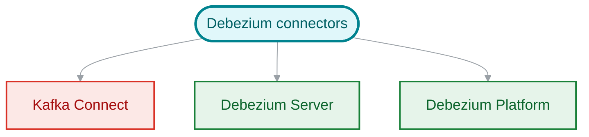
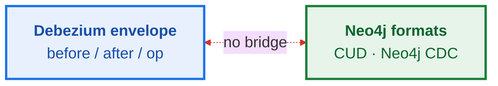
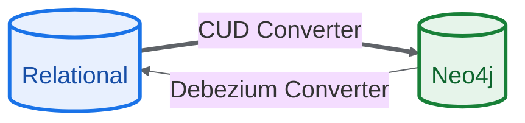
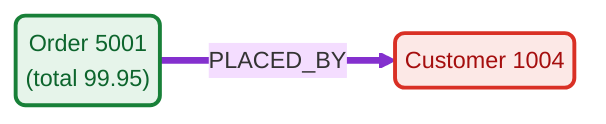

# <span class="whitespace-nowrap">Debezium ↔ Neo4j</span>
## Closing the CDC loop

Bidirectional CDC
relational ⇄ graph

---
layout: center
---

# Why we're here

## Idea · Feedback · Collaboration

A conversation, not a finished pitch.

---

# What is Debezium

**Change data capture, from the transaction log.**


Real-time · low impact · Postgres, MySQL, Oracle, Mongo, …

---

# Three ways to run it



---
layout: center
---

# Why Neo4j

## You asked for it.

* 📊 **Community Poll** ➜ **Neo4j was the most requested graph database**
* 🏆 **Graph Leader** ➜ Leader of graph databases with massive adoption
* 🔌 **The Gap** ➜ Historically, Debezium has had no integrations with graph databases

---

# The gap

Two formats that don't meet.



**Missing piece: the translation.**

---

# The idea: two SMTs, one loop



Stateless · one message at a time · sync in **either direction**

---

# SMT Relational to Graph
### Neo4j CUD Converter


---

# SMT Relational to Graph: CUD Transformation



A single `orders` row produces **two distinct CUD events** (Node + Relationship):

<div class="grid grid-cols-2 gap-4 text-left max-w-full">
<div>

**1. Node Merge Event (`Order`):**
```json
{
  "type": "node",
  "op": "merge",
  "labels": ["Order"],
  "ids": {
    "id": 5001
  },
  "properties": {
    "total": 99.95,
    "status": "pending"
  }
}
```

</div>
<div>

**2. Relationship Merge Event:**
```json
{
  "type": "relationship",
  "op": "merge",
  "rel_type": "PLACED_BY",
  "from": {
    "labels": ["Order"],
    "ids": { "id": 5001 },
    "op": "merge"
  },
  "to": {
    "labels": ["Customer"],
    "ids": { "id": 1004 },
    "op": "match"
  }
}
```

</div>
</div>

---

# SMT Relational to Graph: Output Modes: Array vs Single

<div class="grid grid-cols-12 gap-6 text-left mt-3 max-w-full">
<div class="col-span-4 flex flex-col justify-start text-sm">

**The SMT Constraint:**
One input record produces exactly one output record in Kafka Connect.

**The Graph Challenge:**
A single relational row (e.g. order with FK) contains **both** a Node and a Relationship.

We offer two output modes to bridge this gap.

</div>
<div class="col-span-8 flex flex-col justify-start border-l border-zinc-800 pl-5 text-sm">

**`output.mode = array`** *(default: packs Node & Rel into JSON array)*
<div style="display: flex; gap: 1rem; margin-top: 0.25rem;">
<div style="flex: 1;">

**👎 Cons**
* Requires downstream split/transform step.

</div>
<div style="flex: 1;">

**👍 Pros**
* Guarantees absolute ordering of merges.

</div>
</div>

<div class="mt-3 pt-2 border-t border-zinc-800">

**`output.mode = single`** *(emits 1 CUD event per relational event)*
<div style="display: flex; gap: 1rem; margin-top: 0.25rem;">
<div style="flex: 1;">

**👎 Cons**
* 2 connectors double CDC load
* ⚠️ Zombie Nodes & Race Conditions

</div>
<div style="flex: 1;">

**👍 Pros**
* Directly consumable by Neo4j sink.

</div>
</div>

</div>

</div>
</div>

---

# SMT Relational to Graph: Automated Configuration *(proposed)*
### Schema introspection via the Debezium CLI

Manual configuration of per-table mappings is verbose and error-prone. We're **proposing** to generate it directly from the relational schema (future work, not in V1):

<div class="grid grid-cols-2 gap-8 text-left mt-4 max-w-full">
<div class="flex flex-col justify-start">

**Automatic Mapping Rules:**
* **Primary keys** $\rightarrow$ `node.id.properties`
* **Foreign keys** $\rightarrow$ relationship mappings (`type`, `target.label`, `target.id`)
* **Join tables** (PK is composite FKs) $\rightarrow$ `node.mode = relationship`

</div>
<div class="flex flex-col justify-start">

**CLI Command:**
```bash
debezium configure transformation \
  --type neo4j-cud \
  --config dbz.yaml \
  --format server|connect \
  --transform-name neo4j
```

</div>
</div>

---

# SMT Relational to Graph: Pros & cons

<div class="grid grid-cols-2 gap-8 mt-6 items-start">
<div class="flex flex-col">

### 👎 Cons
- Verbose configuration-based setup
- No DDL propagation
- `array` output needs a split step

</div>
<div class="flex flex-col">

### <span class="pl-12">👍 Pros</span>
- Reuses existing connectors
- Rich per-table control
- Stateless & simple

</div>
</div>

---

# SMT Graph to Relational
### Neo4j Debezium Converter


**Zero-config by default** Neo4j CDC events are self-describing.

---

# SMT Graph to Relational: Example

<div class="grid grid-cols-2 gap-4 text-left max-w-full">
<div>

**1. In: Neo4j CDC**
```json
{
  "event": {
    "eventType": "n",
    "operation": "c",
    "labels": ["Customer"],
    "keys": { "Customer": [{ "id": 1004 }] },
    "state": {
      "before": null,
      "after": {
        "properties": {
          "id": 1004,
          "email": "john@foo.org"
        }
      }
    }
  },
  "metadata": { "txId": 12 }
}
```

</div>
<div>

**2. Out: Debezium Envelope**
```json
{
  "op": "c",
  "source": {
    "connector": "neo4j",
    "table": "Customer",
    "txId": 12
  },
  "after": {
    "id": 1004,
    "email": "john@foo.org"
  }
}
```

</div>
</div>

---

# SMT Graph to Relational: Bridging Graph to Relational Schema

<div class="grid grid-cols-2 gap-6 text-left mt-3 max-w-full text-sm">
<div class="flex flex-col justify-start">

**Graph Reality** *(schema-optional)*
* Same-label nodes can have different properties.
* Property types can evolve dynamically.
* Relationships are flexible across node types.

</div>
<div class="flex flex-col justify-start">

**SMT 2 Adaptation Strategy**
* **Self-describing CDC:** Table names from primary labels; columns from event property maps.
* **Schema-typed Envelopes:** Connect Schema built per-record from the event's typed payload (`EXTENDED` mode).
* **Pre-existing Schemas:** Explicit table & column *name* overrides map graph entities onto existing tables.
* **Missing Field Behavior:** Configurable (`fail` / `warn` / `ignore`).

</div>
</div>

---

# SMT Graph to Relational: Identity & Key Constraints
### Why business keys are strictly required

A relational row needs a stable, portable primary key. Neo4j has two identity concepts:

1. **`elementId`**: System-generated and unstable. Changes across backup/restore, database migrations, and cluster re-membership.
2. **`keys` Map**: Populated by Neo4j CDC only when unique or key constraints exist on labels/relationships.

**The SMT's design decision:**
* We **strictly require key constraints** to populate `keys`.
* We **refuse to fall back to `elementId`** as a surrogate primary key.

---

# SMT Graph to Relational: Ordering & Referential Integrity
### Solving the cross-topic constraint challenge

Kafka guarantees ordering only within a single partition. Nodes and relationships land on different topics/partitions, so relationship updates may arrive before parent rows exist!

As a **stateless SMT**, we cannot buffer, reorder, or create placeholder parent rows.

**Recommended Edge Solutions:**
* **Eventual Consistency:** Allow the relational sink to retry failed writes until endpoints exist.
* **Defer Constraints:** Defer or relax foreign-key constraints on the target database (e.g. `DEFERRABLE INITIALLY DEFERRED` in PostgreSQL).
* **Upstream Key Strategy:** Configure the Neo4j source connector with `key-strategy=ENTITY_KEYS` to ensure strict per-entity ordering in Kafka.

---

# SMT Graph to Relational: Pros & cons

<div class="grid grid-cols-2 gap-8 mt-6 items-start">
<div class="flex flex-col">

### 👎 Cons
- Keys must come from constraints
- Cross-topic ordering (node vs relationship)

</div>
<div class="flex flex-col">

### <span class="pl-12">👍 Pros</span>
- Zero-config by default
- Feeds any JDBC target
- Schema-typed envelope

</div>
</div>

---

# Why this matters for Neo4j

<div class="grid grid-cols-2 gap-5 mt-6 text-sm">
<div class="border border-zinc-700 rounded p-4 flex flex-col gap-2">

**📈 Grow the addressable market**

No bespoke ETL to adopt Neo4j — just a Kafka SMT. Teams already on Debezium drop it into an existing connector, with no new infrastructure.

</div>
<div class="border border-zinc-700 rounded p-4 flex flex-col gap-2">

**🔓 Unlock new use-cases**

Two-way sync enables hybrid setups: the graph as analytical layer, the RDBMS as system of record. No manual data movement, and a relational audit trail for regulated environments.

</div>
</div>

---

# Where we are & what's next

- ✅ Relational → Graph: **built + documented**
- 📝 Graph → Relational: **in progress**
- ⏭️ Next: your feedback ➜ avoid verbose configuration by inferring field mappings.

---

# Thank you

**Debezium × Neo4j**

- 🛠️ Debezium Main Repo: [debezium/debezium](https://github.com/debezium/debezium)
- 📝 Debezium Design Documents: [debezium/design-documents](https://github.com/debezium/design-documents)
- 📘 SMT 1 (Relational → Graph): [DDD-55: Neo4j CUD Converter](https://github.com/debezium/design-documents/blob/main/design/DDD-55.md)
- 📙 SMT 2 (Graph → Relational): [DDD-74: Neo4j Debezium Converter](https://github.com/debezium/design-documents/blob/main/design/DDD-74.md)
