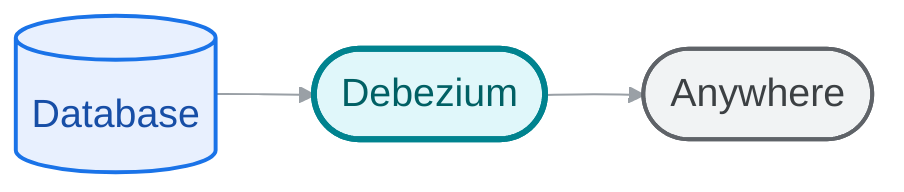
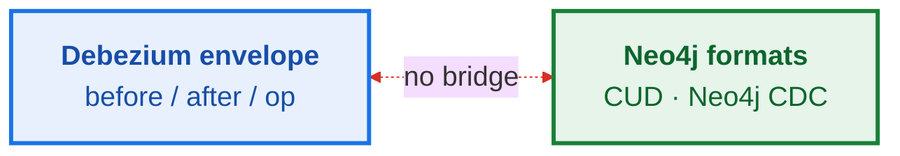
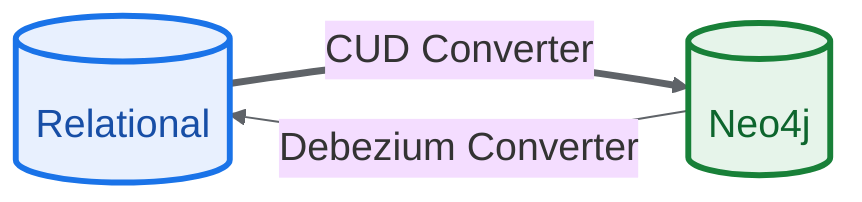
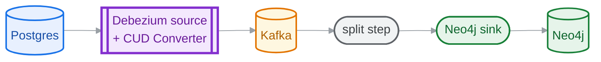
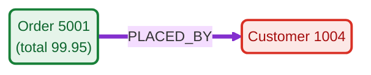
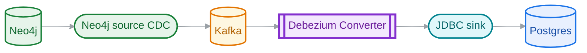

# <span class="whitespace-nowrap">Debezium ↔ Neo4j</span>
## Closing the CDC loop

Bidirectional CDC
relational ⇄ graph

<!--
Hey everyone, thanks for jumping on this meeting. I'm Vincenzo Santonastaso, one of the maintainers of Debezium. With me also Jorge and Jiri from the Debezium team.

We've been working on a bidirectional CDC bridge to link up relational databases with Neo4j, and we wanted to get you guys in a room to show briefly how we're doing it. The goal is to close the CDC loop between relational schemas and graphs, and we really want to get your eyes on it.
-->

---
layout: center
---

# Why we're here

## Idea · Feedback · Collaboration

A conversation, not a finished pitch.

<!--
Just to set expectations: this is not a finished kind of sales pitch or something similar. We're here to brainstorm.
We won't go into too much technical detail because the code is public and debezium is an open-source project. There is also a complete end-to-end example in our repository to help you understand everything better. The idea is to provide a high-level overview of how we are approaching this integration.

The relational-to-graph side is built and documented, but the graph-to-relational side is still ongoing. We are working on this first version of this integration. So if you want, cut me off, ask questions, tell me if something sounds crazy. Let's make this an open discussion.
-->

---

# What is Debezium

**Change data capture, from the transaction log.**



Real-time · low impact · Postgres, MySQL, Oracle, Mongo, …

<!--
Quick recap on Debezium, because I'm not sure that all of you already know it. We do real-time change data capture.

Instead of hammering the source database with polling queries, we tail the actual transaction logs, like the WAL in Postgres or the binlog in MySQL. This gives us event streaming with basically minimal query overhead on the database itself.
-->

---

# Three ways to run it


<!--
Now, how does a team actually run Debezium? There are three main flavors. 

The most common path, and our bread and butter, is running source and sink connectors on top of a standard  Kafka Connect cluster.
But some architectures don't want the heavy operational footprint of Kafka. For them, we provide Debezium Server and Debezium Platform. These are lightweight, standalone runtimes that simulate kafka connect. Rather than pushing to a Kafka topic, they stream events directly from the source to target endpoints, offering the option to choose where to store the offset and schema history. 

Today's designs focus on the Kafka Connect pipeline, but we will guarantee compatibility with the other deployment flavours, too.
-->

---
layout: center
---

# Why Neo4j

## You asked for it.

* 📊 **Community Poll** ➜ **Neo4j was the most requested graph database**
* 🏆 **Graph Leader** ➜ Leader of graph databases with massive adoption
* 🔌 **The Gap** ➜ Historically, Debezium has had no integrations with graph databases

<!--
Historically, Debezium has only operated with relational datastores and several NoSQL ones, but this is our very first entry into the graph space.

So, why Neo4j? We ran a community poll  asking what graph databases people wanted us to support, and Neo4j won.

Also after our first analysis and research, Neo4j is the leader of graph datastores and has a great adoption rate, so for sure it was a great and natural choice for us.
-->

---

# The gap

Two formats that don't meet.



**Missing piece: the translation.**

<!--
But we ran into a structural gap. Debezium provides nested JSON envelopes with 'before', 'after', and transactional metadata. Neo4j, on the other hand, expects graph-native formats like CUD events.

There was no native bridge to translate between them in real-time, which is the exact gap we're trying to bridge.
-->

---

# The idea: two SMTs, one loop



Stateless · one message at a time · sync in **either direction**

<!--
Instead of writing heavy, specialized connectors for every single database out there, we're introducing two lightweight, stateless Single Message Transformation (SMTs).

The first SMT is the 'Neo4j CUD Converter'. It handles the Relational-to-Graph direction.

The second SMT is the 'Neo4j Debezium Converter'. It does the reverse, turning Neo4j source CDC events back into flat Debezium envelopes. Together, they give us a neat, stateless bidirectional loop.
-->

---

# SMT Relational to Graph
### Neo4j CUD Converter



<!--
Let's look at the Relational-to-Graph SMT first, which is already built and documented.

The pipeline is pretty straightforward: the SMT runs on the Debezium source connector side. It intercepts each Debezium envelope event as it's produced, transforms it into a CUD JSON payload, and writes it onto the Debezium Kafka topics. In the default array mode a split step explodes those arrays into individual CUD records that the official Neo4j Sink Connector consumes directly. This is great because we don't have to reinvent the wheel on the sink side.
-->

---

# SMT Relational to Graph: CUD Transformation



A single `orders` row produces **two distinct CUD events** (Node + Relationship):

<div class="grid grid-cols-2 gap-4 text-left max-w-full">
<div>

**1. Node Merge Event (`Order`):**
```json
{
  "type": "node",
  "op": "merge",
  "labels": ["Order"],
  "ids": {
    "id": 5001
  },
  "properties": {
    "total": 99.95,
    "status": "pending"
  }
}
```

</div>
<div>

**2. Relationship Merge Event:**
```json
{
  "type": "relationship",
  "op": "merge",
  "rel_type": "PLACED_BY",
  "from": {
    "labels": ["Order"],
    "ids": { "id": 5001 },
    "op": "merge"
  },
  "to": {
    "labels": ["Customer"],
    "ids": { "id": 1004 },
    "op": "match"
  }
}
```

</div>
</div>

<!--
Let's look briefly at what this transformation actually does. Let's say we have an orders table in SQL, and someone inserts a row. That row has an id of 5001, a total of 99.95, and a foreign key customer_id pointing to 1004.

In a graph database, that single row actually represents two separate physical entities. It's a Node representing the Order itself, and a Relationship (let's call it PLACED_BY) that connects that order to a Customer node.

What's really interesting here is that relational schemas already contain a surprising amount of graph information. Primary keys identify entities. Foreign keys identify relationships. Join tables often represent relationships directly. In many ways, we're not inventing a graph model from scratch here. We are extracting one that was already present in the relational schema and simply making it explicit. The Relational-to-Graph SMT handles this mapping by configuration provided by the user. It parses the row and generates two distinct CUD events. On the left, you see the Node Merge event: it grabs the primary key as the ID, maps the other columns as properties, and automatically strips out the foreign key because it shouldn't exist as a properties field on the node. On the right, it concurrently generates a Relationship Merge event, mapping the PLACED_BY relationship from the Order node to the Customer node using their respective unique IDs. It's clean, automatic, and fully structured.
-->

---

# SMT Relational to Graph: Output Modes: Array vs Single

<div class="grid grid-cols-12 gap-6 text-left mt-3 max-w-full">
<div class="col-span-4 flex flex-col justify-start text-sm">

**The SMT Constraint:**
One input record produces exactly one output record in Kafka Connect.

**The Graph Challenge:**
A single relational row (e.g. order with FK) contains **both** a Node and a Relationship.

We offer two output modes to bridge this gap.

</div>
<div class="col-span-8 flex flex-col justify-start border-l border-zinc-800 pl-5 text-sm">

**`output.mode = array`** *(default: packs Node & Rel into JSON array)*
<div style="display: flex; gap: 1rem; margin-top: 0.25rem;">
<div style="flex: 1;">

**👎 Cons**
* Requires downstream split/transform step.

</div>
<div style="flex: 1;">

**👍 Pros**
* Guarantees absolute ordering of merges.

</div>
</div>

<div class="mt-3 pt-2 border-t border-zinc-800">

**`output.mode = single`** *(emits 1 CUD event per relational event)*
<div style="display: flex; gap: 1rem; margin-top: 0.25rem;">
<div style="flex: 1;">

**👎 Cons**
* 2 connectors double CDC load
* ⚠️ Zombie Nodes & Race Conditions

</div>
<div style="flex: 1;">

**👍 Pros**
* Directly consumable by Neo4j sink.

</div>
</div>

</div>

</div>
</div>

<!--
Now, a single relational row just produced two CUD events, but a Kafka Connect SMT is one-in, one-out. How we emit both, and how we keep the node ordered before its relationship, is exactly what the `output.mode` setting controls.
We designed two output modes to handle multiple linked events.
First, `output.mode = array`. This is our default. It packs both the Node and Relationship events into a single JSON array inside one event. This guarantees absolute ordering (meaning the node is guaranteed to exist before the relationship is created) but it forces you to run a split step in Kafka.\
Second, `output.mode = single`. This emits exactly one event per relational change. This is not reccomended and could cause nasty race conditions: like relationships arriving before nodes exist, or zombie nodes come back to life after a delete but it dows not require split step
-->

---

# SMT Relational to Graph: Automated Configuration *(proposed)*
### Schema introspection via the Debezium CLI

Manual configuration of per-table mappings is verbose and error-prone. We're **proposing** to generate it directly from the relational schema (future work, not in V1):

<div class="grid grid-cols-2 gap-8 text-left mt-4 max-w-full">
<div class="flex flex-col justify-start">

**Automatic Mapping Rules:**
* **Primary keys** $\rightarrow$ `node.id.properties`
* **Foreign keys** $\rightarrow$ relationship mappings (`type`, `target.label`, `target.id`)
* **Join tables** (PK is composite FKs) $\rightarrow$ `node.mode = relationship`

</div>
<div class="flex flex-col justify-start">

**CLI Command:**
```bash
debezium configure transformation \
  --type neo4j-cud \
  --config dbz.yaml \
  --format server|connect \
  --transform-name neo4j
```

</div>
</div>

<!--
One major pain point we noticed early was that writing these per-table mappings by hand is incredibly tedious. If you have a hundred tables, configuring every node ID, label, and relationship is a nightmare.

To fix that, we want to add a command to the Debezium CLI. It inspects your relational schema and auto-generates the entire CUD configuration. It maps primary keys to node IDs, foreign keys to relationship merges, and even detects join tables to map them directly as relationships. It basically makes the Relational-to-Graph SMT plug-and-play.
-->

---

# SMT Relational to Graph: Pros & cons

<div class="grid grid-cols-2 gap-8 mt-6 items-start">
<div class="flex flex-col">

### 👎 Cons
- Verbose configuration-based setup
- No DDL propagation
- `array` output needs a split step

</div>
<div class="flex flex-col">

### <span class="pl-12">👍 Pros</span>
- Reuses existing connectors
- Rich per-table control
- Stateless & simple

</div>
</div>

<!--
To wrap up the Relational-to-Graph SMT: the pros are that we reuse your existing connectors, we get fine-grained control, and it's stateless with no state to manage and no consistency issues.

The cons are that configuring it can still be verbose behind the scenes, there's no automatic DDL schema propagation to the graph, and array mode force you to have an extra split step. Let's switch to the Graph-to-Relational SMT.
-->

---

# SMT Graph to Relational
### Neo4j Debezium Converter



**Zero-config by default** Neo4j CDC events are self-describing.

<!--
Here the flow is simple. Neo4j's own CDC source connector reads changes from Neo4j and sends them into Kafka. Our SMT picks up each event and turns it into a normal Debezium envelope. Then any standard JDBC sink writes it into Postgres, MySQL, or whatever you use.

The nice part: Neo4j CDC events describe themselves. So this SMT needs no configuration by default. It reads the table name, the columns, the keys, and the values directly from the event.
-->

---

# SMT Graph to Relational: Example

<div class="grid grid-cols-2 gap-4 text-left max-w-full">
<div>

**1. In: Neo4j CDC**
```json
{
  "event": {
    "eventType": "n",
    "operation": "c",
    "labels": ["Customer"],
    "keys": { "Customer": [{ "id": 1004 }] },
    "state": {
      "before": null,
      "after": {
        "properties": {
          "id": 1004,
          "email": "john@foo.org"
        }
      }
    }
  },
  "metadata": { "txId": 12 }
}
```

</div>
<div>

**2. Out: Debezium Envelope**
```json
{
  "op": "c",
  "source": {
    "connector": "neo4j",
    "table": "Customer",
    "txId": 12
  },
  "after": {
    "id": 1004,
    "email": "john@foo.org"
  }
}
```

</div>
</div>

<!--
Here's an example. On the left is the raw Neo4j CDC event: a new Customer node, with its properties and its key.

The SMT takes that and builds the Debezium envelope on the right. It uses the label Customer as the table name, puts the properties in the after field, and sets the operation to c for create. To the JDBC sink, this looks just like any normal database change.
-->

---

# SMT Graph to Relational: Bridging Graph to Relational Schema

<div class="grid grid-cols-2 gap-6 text-left mt-3 max-w-full text-sm">
<div class="flex flex-col justify-start">

**Graph Reality** *(schema-optional)*
* Same-label nodes can have different properties.
* Property types can evolve dynamically.
* Relationships are flexible across node types.

</div>
<div class="flex flex-col justify-start">

**SMT 2 Adaptation Strategy**
* **Self-describing CDC:** Table names from primary labels; columns from event property maps.
* **Schema-typed Envelopes:** Connect Schema built per-record from the event's typed payload (`EXTENDED` mode).
* **Pre-existing Schemas:** Explicit table & column *name* overrides map graph entities onto existing tables.
* **Missing Field Behavior:** Configurable (`fail` / `warn` / `ignore`).

</div>
</div>

<!--
Fitting a flexible graph into a strict SQL database is the hard part. In Neo4j, two nodes with the same label can have different properties, a property's type can change over time, and one relationship type can link many kinds of nodes. SQL tables are not that forgiving.

We handle this in three ways.

First, we build the schema for each record on the fly, from the properties in that event. So we don't need to know the columns up front. The user should definetly ensure that the Neo4j schema structure is aligned with the relational schema since there is not DDL propagation


Second, if the target database already exists with fixed names, you can add overrides that map Neo4j labels and properties onto your existing table and column names. 
Third, there's a setting called field.missing.behavior for when an event is missing something we need, for example no key, no clear owning label, or no before/after image. You can control what happens: fail stops and hands the record to Kafka Connect's error handling, warn logs it and drops the record, and ignore drops it without any log.
-->

---

# SMT Graph to Relational: Identity & Key Constraints
### Why business keys are strictly required

A relational row needs a stable, portable primary key. Neo4j has two identity concepts:

1. **`elementId`**: System-generated and unstable. Changes across backup/restore, database migrations, and cluster re-membership.
2. **`keys` Map**: Populated by Neo4j CDC only when unique or key constraints exist on labels/relationships.

**The SMT's design decision:**
* We **strictly require key constraints** to populate `keys`.
* We **refuse to fall back to `elementId`** as a surrogate primary key.

<!--
This is a big design decision, about identity. A relational table needs a stable primary key to do updates and deletes. Neo4j gives us two options: the system-generated elementId, and the keys map that you define with a constraint.

We made a strong rule: we only use the keys map, and we never fall back to elementId. The reason is that elementId is not stable. It can change after a backup and restore, a migration, or a cluster change. If we relied on it, over time the keys would stop matching the relational rows, and the data would quietly get corrupted.
-->

---

# SMT Graph to Relational: Ordering & Referential Integrity
### Solving the cross-topic constraint challenge

Kafka guarantees ordering only within a single partition. Nodes and relationships land on different topics/partitions, so relationship updates may arrive before parent rows exist!

As a **stateless SMT**, we cannot buffer, reorder, or create placeholder parent rows.

**Recommended Edge Solutions:**
* **Eventual Consistency:** Allow the relational sink to retry failed writes until endpoints exist.
* **Defer Constraints:** Defer or relax foreign-key constraints on the target database (e.g. `DEFERRABLE INITIALLY DEFERRED` in PostgreSQL).
* **Upstream Key Strategy:** Configure the Neo4j source connector with `key-strategy=ENTITY_KEYS` to ensure strict per-entity ordering in Kafka.

<!--
The other hard problem is ordering. Kafka only keeps order inside one partition. Nodes and relationships go to different topics and partitions, so a relationship can reach the sink before the related nodes.

And because our SMT is stateless, it can't hold events back or invent placeholder rows to fix this.

So we suggest three options, all at the edges of the pipeline.
First, eventual consistency: let the JDBC sink keep retrying a failed write until the parent rows show up.
Second, relax the constraints: tell the target database to check foreign keys later, for example  in Postgres we have DEFERRABLE INITIALLY setting to control it.
Third, key strategy: set the Neo4j source connector to key-strategy=ENTITY_KEYS. One thing to be clear about: this only keeps order per entity, like create-then-update of the same row. It does not guarantee a node arrives before a relationship that points to it.

**Prompt for Neo4j Team:** how do your customers usually handle this ordering problem when they stream Neo4j CDC into a downstream database? We'd love to hear what works.
-->

---

# SMT Graph to Relational: Pros & cons

<div class="grid grid-cols-2 gap-8 mt-6 items-start">
<div class="flex flex-col">

### 👎 Cons
- Keys must come from constraints
- Cross-topic ordering (node vs relationship)

</div>
<div class="flex flex-col">

### <span class="pl-12">👍 Pros</span>
- Zero-config by default
- Feeds any JDBC target
- Schema-typed envelope

</div>
</div>

<!--
Quick summary of this SMT. On the plus side: no configuration needed to start, it works with any JDBC sink, and the envelopes it produces are fully typed.

On the minus side: it needs constraints on your graph to get keys, and it leaves the cross-topic ordering problem to the database side. We think this is the cleanest design for a stateless SMT, but we will work to improve and avoid this kind of constraints.
-->

---

# Why this matters for Neo4j

<div class="grid grid-cols-2 gap-5 mt-6 text-sm">
<div class="border border-zinc-700 rounded p-4 flex flex-col gap-2">

**📈 Grow the addressable market**

No bespoke ETL to adopt Neo4j — just a Kafka SMT. Teams already on Debezium drop it into an existing connector, with no new infrastructure.

</div>
<div class="border border-zinc-700 rounded p-4 flex flex-col gap-2">

**🔓 Unlock new use-cases**

Two-way sync enables hybrid setups: the graph as analytical layer, the RDBMS as system of record. No manual data movement, and a relational audit trail for regulated environments.

</div>
</div>

<!--
Briefly, why this matters for Neo4j.

one of the blocker to adopting Neo4j is the cost of moving — years of data and pipelines on relational databases. These SMTs reduce significantly that cost: you don't migrate, you stream. And a team already on Debezium just adds one SMT to a connector they have, with no new infrastructure.

It also opens up new use cases. Because the sync goes both ways, you can build hybrid, heterogeneous setups where a graph and a relational database run side by side and stay in sync — each one used for what it's best at.
-->

---

# Where we are & what's next

- ✅ Relational → Graph: **built + documented**
- 📝 Graph → Relational: **in progress**
- ⏭️ Next: your feedback ➜ avoid verbose configuration by inferring field mappings.

<!--
Where we are and what's next
The Relational-to-Graph SMT is fully built and documented; the Graph-to-Relational SMT is currently in progress. Next up: we'd love your feedback on both, and we want to eliminate verbose manual configuration by inferring field mappings directly from the schemas on both ends.
-->

---

# Thank you

**Debezium × Neo4j**

- 🛠️ Debezium Main Repo: [debezium/debezium](https://github.com/debezium/debezium)
- 📝 Debezium Design Documents: [debezium/design-documents](https://github.com/debezium/design-documents)
- 📘 SMT 1 (Relational → Graph): [DDD-55: Neo4j CUD Converter](https://github.com/debezium/design-documents/blob/main/design/DDD-55.md)
- 📙 SMT 2 (Graph → Relational): [DDD-74: Neo4j Debezium Converter](https://github.com/debezium/design-documents/blob/main/design/DDD-74.md)

<!--
Thank you again for your time.
-->
